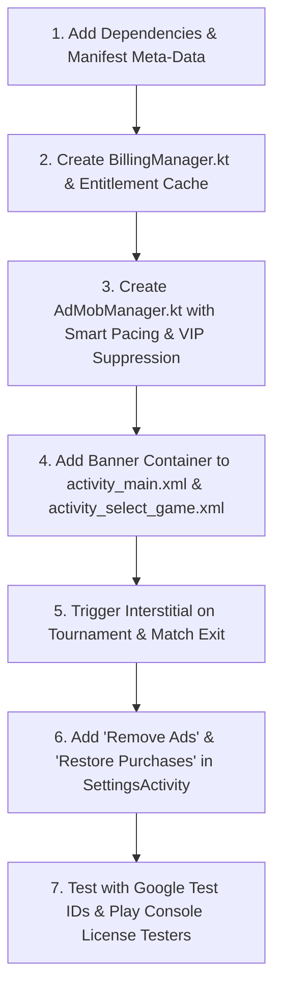

# 💰 Funtoza: In-App Purchases (IAP) & Google AdMob Monetization Architecture

> **Application Package Name:** `com.aaritlabs.funtoza`  
> **Target SDK:** 36 (Android 15 / 16) | **Min SDK:** 24 (Android 7.0)  
> **Billing Library:** Google Play Billing 8.0.0  
> **AdMob SDK:** Google Mobile Ads 23.6.0  

---

## 📋 Table of Contents
1. [Monetization Strategy Overview](#1-monetization-strategy-overview)
2. [Google Play Console — In-App Purchases (IAP) Configuration](#2-google-play-console--in-app-purchases-iap-configuration)
3. [Google AdMob — Account & Ad Units Configuration](#3-google-admob--account--ad-units-configuration)
4. [Android SDK & Gradle Dependencies](#4-android-sdk--gradle-dependencies)
5. [AndroidManifest.xml Requirements](#5-androidmanifestxml-requirements)
6. [Implementation Architecture & Code Classes](#6-implementation-architecture--code-classes)
7. [Step-by-Step Implementation Roadmap](#7-step-by-step-implementation-roadmap)

---

## 1. Monetization Strategy Overview

Because Funtoza is an **offline 1–4 player party game played on the same screen**, ads must **never interrupt live gameplay**. An aggressive ad strategy will frustrate players sitting together.

### The Hybrid Monetization Blueprint:
| Monetization Pillar | Implementation | Player Impact |
| :--- | :--- | :--- |
| **Non-Consumable IAP** | **"Remove Ads VIP"** one-time purchase | Instantly & permanently silences all Banners and Interstitials across the entire app. |
| **Adaptive Banners** | Displayed in non-gameplay screens (Lobby / Mode Select / Cup Standings). Never during active round canvas. | Passive revenue without gameplay distraction. |
| **Paced Interstitials** | Displayed **only** when returning to Home from a match, or at the end of a Cup Tournament. Capped to **max 1 every 3.5 minutes**. | Natural break points; never mid-duel. |
| **Rewarded Video Ads** | Optional bonus: Unlock 3 Exclusive VIP Party Minigames or get a Cup Replay Token. | 100% opt-in; high eCPM. |

---

## 2. Google Play Console — In-App Purchases (IAP) Configuration

### Step-by-Step Setup in Google Play Console:
1. Open [Google Play Console](https://play.google.com/console).
2. Select **Funtoza** (`com.aaritlabs.funtoza`).
3. In the left navigation, scroll to **Monetize with Play** $\rightarrow$ **In-app products**.
4. Click **Create product**.
5. Fill in the details from the table below.
6. Click **Save** and then **Activate**.

### 📊 Google Play Console In-App Products Table

| Product ID (Exact SKU) | Product Type | Default Name | Description | Suggested Price (USD) | Suggested Price (INR) | In-App Entitlement / Benefit |
| :--- | :--- | :--- | :--- | :--- | :--- | :--- |
| `funtoza_remove_ads` | **Non-consumable** (Permanent) | Remove All Ads (VIP) | Permanently removes all banner & interstitial ads. Enjoy 100% ad-free offline gameplay forever! | **$1.99** | **₹99** | Disables all banners, interstitials, and unlocks VIP Crown badge in Settings and Main Menu. |
| `funtoza_vip_party_bundle` | **Non-consumable** (Permanent) | VIP Party Pack | Removes all ads + Unlocks 10 Exclusive Player Avatars & Cosmic Themes! | **$3.99** | **₹199** | All Ads removed + unlocks exclusive squircle neon skins & tournament trophy animations. |
| `funtoza_tip_coffee` | **Consumable** (Repeatable) | Buy Developers a Coffee ☕ | Support AarIt Labs indie game development! | **$0.99** | **₹49** | Thank-you celebration animation + developer appreciation badge. |

> [!IMPORTANT]
> **Testing IAP before Release:**
> 1. In Google Play Console, go to **Setup** $\rightarrow$ **License Testing**.
> 2. Add your Google test account emails (e.g., your personal Gmail logged into your Android test phone).
> 3. Under **License response**, select `RESPOND_NORMALLY`.
> 4. Test accounts will be billed with **Google Play Test Card (Always Approves)** with zero real money charged.

### 🔍 Detailed Explanation of Each In-App Product:

#### 1. `funtoza_remove_ads` (Non-consumable / Permanent)
* **What it is:** The #1 requested purchase in offline mobile party games.
* **How the player buys it:**
  * From the **Settings Screen** (`SettingsActivity`), the player sees a glowing VIP card: *"👑 REMOVE ALL ADS - $1.99 / ₹99"*.
  * Tapping launches Google Play's official native bottom-sheet purchase dialogue.
* **What happens immediately upon purchase:**
  * Google Play returns a signed `Purchase` token.
  * `BillingManager` acknowledges the purchase with Google Play server.
  * Saves `is_vip_no_ads = true` in local encrypted preferences.
  * **All Banner Ads disappear immediately** without needing to restart the app.
  * **All Interstitial & App Open Ads are silenced permanently**.
  * The button in Settings permanently updates to a shiny badge: *"✓ VIP ACTIVATED • AD FREE"*.
* **Reinstalling / Device Switching:**
  * Because it is a **Non-consumable**, whenever the user installs Funtoza on a new phone with the same Google account, tapping *"Restore Purchases"* (or simply opening the app) automatically queries Google Play and re-activates ad-free mode for free!

#### 2. `funtoza_vip_party_bundle` (Non-consumable / Permanent)
* **What it is:** The "Ultimate Experience" pack for parties and family gatherings.
* **What it unlocks:**
  1. **All Ads Removed Permanently** (same as `funtoza_remove_ads`).
  2. **All 10 Minigames 100% Unlocked Forever** (including Sea Battle ⚓ and Memory 🧠 with zero rewarded ads required).
  3. **Exclusive Neon Player Skins & Avatars**: Gold, Diamond, and Cyberpunk squircles for P1, P2, P3, and P4.
  4. **Golden Cup Trophy animations** in Party Tournaments.

#### 3. `funtoza_tip_coffee` (Consumable / Repeatable)
* **What it is:** A voluntary indie-developer donation ("Buy Developers a Coffee ☕").
* **Why it is "Consumable":**
  * A consumable product can be bought **multiple times** (unlike Remove Ads which can only be bought once).
  * After the player buys it, `BillingManager` calls `billingClient.consumeAsync(...)`. This resets the product on Google Play so the supporter can buy it again whenever they wish.
* **What the player receives:**
  * An instant celebratory full-screen confetti starburst blast (`CelebrationStarBlastView`).
  * A warm thank-you dialogue with an AarIt Labs Supporter badge.

---

### 🎮 Which Games are Unlocked by the Rewarded Video Ad?

Funtoza has 10 minigames. To balance player satisfaction and high ad revenue:

| Minigame | Access Type | How it Works |
| :--- | :--- | :--- |
| **Ludo 🎲, Finger Soccer ⚽, Neon Snake 🐍, Snakes & Ladders 🪜, Target Blitz 🎯, Tic Tac Toe ❌, Dots & Boxes ⏹️, Oops! 🃏** | **100% Free Always** | These 8 classic games are always available to all players immediately with no restrictions. |
| **Sea Battle ⚓** *(Naval Warship Combat)* | **Premium / Rewarded Unlock** | Non-VIP players can watch **1 short rewarded video ad** to unlock Sea Battle for **24 hours** (or for the current gaming session). VIP users have it unlocked permanently! |
| **Memory 🧠** *(Flip & Match Brain Duel)* | **Premium / Rewarded Unlock** | Non-VIP players can watch **1 short rewarded video ad** to unlock Memory for **24 hours**. VIP users have it unlocked permanently! |
| **Bonus Party Cup Replays** | **Rewarded Unlock** | When finishing a Cup Tournament, non-VIP players can watch 1 rewarded video to instantly replay or retry the tournament with extra score multipliers. |

## 3. Google AdMob — Account & Ad Units Configuration

### Step-by-Step Setup in Google AdMob:
1. Log into [Google AdMob Console](https://apps.admob.com/).
2. Click **Apps** $\rightarrow$ **Add App**.
3. Select **Android** $\rightarrow$ Is the app listed on a supported app store? (Select **No** during development, link Play Store URL later).
4. Enter App Name: **Funtoza: 1-4 Player Games**.
5. Once created, copy your **AdMob App ID** (`ca-app-pub-xxxxxxxxxxxxxxxx~yyyyyyyyyy`).
6. Navigate to **Ad units** $\rightarrow$ **Add Ad Unit** and create the 4 ad formats below.

### 📊 Google AdMob Ad Units Table (Funtoza Configuration)

**AdMob App ID:** `ca-app-pub-4917639294278231~2129411174`

| Ad Unit Name | Format | Ad Placement in Funtoza | Production Ad Unit ID (Configured in Code) | Frequency Cap / Settings |
| :--- | :--- | :--- | :--- | :--- |
| **Funtoza_Home_Banner** | Adaptive Banner | Bottom of Main Menu (`activity_main.xml`) & Game Selection (`activity_select_game.xml`) | `ca-app-pub-4917639294278231/1447894057` | Auto-refresh every 45-60s. Auto-hidden during active match canvas and for VIP users. |
| **Funtoza_Match_Interstitial** | Interstitial | Displayed when clicking "Exit to Menu" or completing a match / Cup Tournament | `ca-app-pub-4917639294278231/7872692444` | Seamless exit-to-menu ad display. Never interrupts ongoing gameplay; permanently suppressed if VIP. |
| **Funtoza_Reward_Unlock** | Rewarded Video | Unlock Premium Games (Sea Battle ⚓, Memory 🧠) for 24 hours OR get Instant Tournament Replay Token | `ca-app-pub-4917639294278231/9813681265` | 100% User-initiated opt-in. Unlocks 24-hour access to Sea Battle and Memory. |
| **Funtoza_App_Open** | App Open Ad | Foreground resume from background | `ca-app-pub-4917639294278231/6915843150` | **Paced to max 1 per 15 minutes**. Never fires during active match; suppressed if VIP. |

---

## 4. Android SDK & Gradle Dependencies

Add the following libraries to `app/build.gradle.kts` in the `dependencies { ... }` block:

```kotlin
dependencies {
    // ... existing Funtoza dependencies ...

    // Google Play Billing (Latest v8.0.0 with Kotlin Coroutines KTX)
    implementation("com.android.billingclient:billing-ktx:8.0.0")

    // Google Mobile Ads SDK (AdMob)
    implementation("com.google.android.gms:play-services-ads:23.6.0")

    // User Messaging Platform (UMP) SDK for GDPR / CCPA European Consent
    implementation("com.google.android.ump:user-messaging-platform:3.1.0")
}
```

---

## 5. AndroidManifest.xml Requirements

### Permissions:
Google Mobile Ads requires network permissions (AdMob SDK automatically handles most, but standard declarations are best practice):
```xml
<uses-permission android:name="android.permission.INTERNET" />
<uses-permission android:name="android.permission.ACCESS_NETWORK_STATE" />
<uses-permission android:name="com.android.vending.BILLING" />
```

### AdMob Application ID Metadata:
Inside `<application ...>` in `app/src/main/AndroidManifest.xml`:

```xml
<!-- Google Mobile Ads Application ID -->
<!-- Sample Test App ID: ca-app-pub-3940256099942544~3347511713 -->
<!-- Replace with your Real AdMob App ID from the AdMob Console before release! -->
<meta-data
    android:name="com.google.android.gms.ads.APPLICATION_ID"
    android:value="ca-app-pub-3940256099942544~3347511713" />
```

---

## 6. Implementation Architecture & Code Classes

```
app/src/main/java/com/aaritlabs/funtoza/
├── monetization/
│   ├── BillingManager.kt        // Manages Play BillingClient, Purchases & Entitlements
│   ├── AdMobManager.kt          // Manages Banner, Interstitial & Rewarded lifecycle
│   └── ConsentManager.kt        // Manages Google UMP GDPR/CCPA Consent forms
```

### 1. `BillingManager.kt`
* Initializes `BillingClient` with `PurchasesUpdatedListener`.
* Handles connection lifecycle (`startConnection`).
* Queries SKU details for `funtoza_remove_ads` and `funtoza_vip_party_bundle`.
* Launches purchase billing flow on user request.
* Verifies & acknowledges purchases (`acknowledgePurchase`).
* Automatically checks existing active purchases on launch (Restores purchases).
* Updates persistent state in `SharedPreferences`: `is_vip_no_ads = true`.

### 2. `AdMobManager.kt`
* Initialized in `MainActivity.onCreate()` or `Application.onCreate()`.
* Automatically checks `BillingManager.isNoAdsActive(context)`. If active:
  * **Hides all banner views.**
  * **Suppresses all interstitial ads.**
* Preloads Interstitials in the background so they display with zero loading lag.
* Tracks pacing: enforces a minimum cooldown (e.g. 180 seconds) between interstitials.

### 3. Settings Screen Integration (`SettingsActivity.kt`)
* Displays a prominent **"👑 REMOVE ALL ADS (VIP)"** card.
* Shows price dynamically fetched from Google Play (e.g., "$1.99" or "₹99").
* If already purchased, displays a golden badge: **"✓ VIP ACTIVATED • AD FREE"**.
* Adds a **"Restore Purchases"** button for users switching devices.

---

## 7. Step-by-Step Implementation Roadmap



### Verification Checklist:
- [ ] Test purchase with Google Play License Test Account (`funtoza_remove_ads`).
- [ ] Confirm banners disappear immediately upon successful purchase.
- [ ] Confirm no interstitials fire mid-match (gameplay surface stays 100% immersive).
- [ ] Confirm purchases restore cleanly after app uninstall/reinstall.
- [ ] Replace Test AdMob IDs with Production IDs before generating release AAB.

